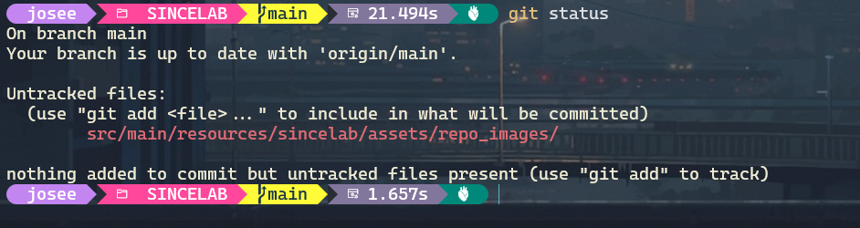
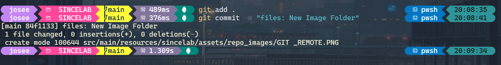
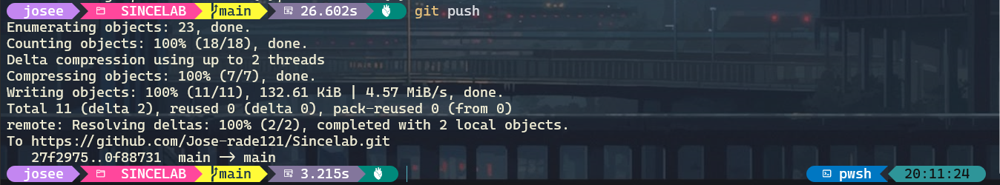

<h1 style = "font-size: 16 px; font-family = Courier New, Consolas, Monaco;" >SINCELAB</h1> 


## Inicializar el repositorio

Para inicializar el repositorio es **necesario** [instalar](https://git-scm.com/book/es/v2/Inicio---Sobre-el-Control-de-Versiones-Instalaci%C3%B3n-de-Git) `Git`;
al finalizar debe abrir la terminar o bash y asignar:

```bash
git --version
```

Si el proceso no da errores, la descarga fue correcta.
Luego de esto, se debe hacer el registro y configuracion de la `cuenta` de GitHub:

```bash
git config --global user.name "Tu Nombre"
git config --global user.email "tu-correo@ejemplo.com"
git config --global init.defaultBranch main
```
Al terminar el registro de la cuenta, traeremos el repositorio a nuestro dispositivo en el lugar donde queramos guardarlo:

```bash
git clone https://github.com/Jose-rade121/Sincelab.git
```

Ingresamos al proyecto con:
```bash
cd sincelab
```
Comprobamos que todo quedo bien:
```bash
git remote -v
```


En caso de que el comando `remote` no muestre nada escribiremos:
```bash
git remote add origin URL
```
Si muestra una `URL` Equivocada:
```bash
git remote set-url origin URL
```


## Añadir cambios al proyecto

### Terminal:

```bash
git status  #Que nuevos cambios hay
```


---

```bash
git add .   #Prepara los cambios
```

```bash
git commit -m "Descripcion de los cambios"
```


---

```bash
git push    #Envia a GitHub
```


---

```bash
git pull    #Trae los nuevos cambios
```


#### Flujo de trabajo:
```bash
git pull    #Trae los nuevos cambios
git status  #Que nuevos cambios hay
git add .   #Prepara los cambios
git commit -m "Descripcion de los cambios"
git push    #Envia a GitHub
```

>[!WARNING]
>Hacer el pull es de vital importancia, si no se hace y se fuerza el envio de la informacion esto podria borrar Archivos importantes.


## Estructura del proyecto

<!-- TREE:START -->
```text
Sincelab/
├── .mvn/
│   └── wrapper/
│       └── maven-wrapper.properties
├── db/
│   └── init.sql
├── src/
│   ├── main/
│   │   ├── java/
│   │   │   └── sincelab/
│   │   │       ├── storage/
│   │   │       │   ├── sesion/
│   │   │       │   │   └── Users.java
│   │   │       │   ├── Archive.java
│   │   │       │   ├── BancoPreguntas.java
│   │   │       │   ├── caidalibre.java
│   │   │       │   ├── Conexion.java
│   │   │       │   ├── derivada.java
│   │   │       │   ├── integrales.java
│   │   │       │   ├── MatrizCuadrada.java
│   │   │       │   ├── mua.java
│   │   │       │   ├── polinomio.java
│   │   │       │   ├── PuntajeDAO.java
│   │   │       │   ├── segundaley.java
│   │   │       │   ├── Seguridad.java
│   │   │       │   ├── UsuarioDAO.java
│   │   │       │   └── Vector3D.java
│   │   │       ├── view/
│   │   │       │   ├── curses/
│   │   │       │   │   ├── algebralineal/
│   │   │       │   │   │   ├── AlgLineal.java
│   │   │       │   │   │   ├── Matrices.java
│   │   │       │   │   │   ├── TeoriaAlg.java
│   │   │       │   │   │   └── Vectores.java
│   │   │       │   │   ├── fisica1/
│   │   │       │   │   │   ├── CaidaLibre.java
│   │   │       │   │   │   ├── CalcFisica.java
│   │   │       │   │   │   ├── Fisica1.java
│   │   │       │   │   │   ├── MovAcelerado.java
│   │   │       │   │   │   ├── SegundaLey.java
│   │   │       │   │   │   └── Theoryf.java
│   │   │       │   │   ├── humanidades/
│   │   │       │   │   │   └── humanidadest.java
│   │   │       │   │   └── matematicas2/
│   │   │       │   │       ├── Derivadas.java
│   │   │       │   │       ├── Integrales.java
│   │   │       │   │       ├── Matematicas2.java
│   │   │       │   │       ├── TecDevInt.java
│   │   │       │   │       └── Theorym.java
│   │   │       │   ├── utilities/
│   │   │       │   │   ├── Header.java
│   │   │       │   │   ├── Pregunta.java
│   │   │       │   │   ├── PrincipalFont.java
│   │   │       │   │   ├── Sesion.java
│   │   │       │   │   ├── Themed.java
│   │   │       │   │   ├── Themes.java
│   │   │       │   │   └── TheoryBlock.java
│   │   │       │   └── windows/
│   │   │       │       ├── AboutWindow.java
│   │   │       │       ├── MainWindow.java
│   │   │       │       ├── Quizwindow.java
│   │   │       │       ├── RankingWindow.java
│   │   │       │       └── UiLogin.java
│   │   │       └── Main.java
│   │   └── resources/
│   │       └── sincelab/
│   │           └── assets/
│   │               ├── fonts/
│   │               │   ├── Bestime.otf
│   │               │   ├── Bestime.ttf
│   │               │   ├── Hey_Comic.ttf
│   │               │   ├── Nunito-Black.ttf
│   │               │   └── Stay_With_Me.otf
│   │               ├── icons/
│   │               │   ├── astronaunt-icon.png
│   │               │   ├── Astronauta.png
│   │               │   ├── fondo.jfif
│   │               │   ├── guardado.png
│   │               │   ├── icon.png
│   │               │   ├── moon_black.png
│   │               │   └── moon_white.png
│   │               └── repo_images/
│   │                   ├── GIT _REMOTE.PNG
│   │                   ├── GIT_ADD_COMMIT.PNG
│   │                   ├── GIT_PULL.PNG
│   │                   ├── GIT_PUSH.PNG
│   │                   └── GIT_STATUS.PNG
│   └── test/
│       └── java/
│           └── sincelab/
│               └── tests/
│                   └── DaoSmoke.java
├── .env.example
├── .gitignore
├── docker-compose.yml
├── mvnw
├── mvnw.cmd
├── nb-configuration.xml
├── nbactions.xml
├── pom.xml
└── README.md
```
<!-- TREE:END -->


### Descripcion de las clases

<h3>Carpeta java</h3>

* Main --> Archivo Principal de la aplicación; en este llama a la ventana principal y a los elementos de storage.

<h3>Carpeta Ui</h3>

* AboutWindow --> Ventana de la informacion de la aplicacion.

* Header --> Encabezado de la aplicacion.

* MainWindow --> Ventana principal, la que se abre al principio.

* PrincipalFont --> Carga las fuentes de letras.

* Themed --> Permite el cambio entre ventanas.

* Themes --> Modos de visualizacion claro y oscuro

<h3><strong>Carpeta Storage</strong></h3>

* FolderCreate --> Crea la carpeta donde se almacenan la informacion.

* Users --> Informacion de los usuarios.


## Puesta en marcha (base de datos y ejecución)

> Requisitos: **JDK 21** y **Docker** (con Docker Compose). El proyecto incluye **Maven Wrapper**, así que no hace falta instalar Maven aparte.

### 1) Configurar el `.env`

En la raíz del proyecto, crea tu `.env` a partir de `.env.example` y completa los valores:

```env
DB_ROOT_PASSWORD=tu_clave_root
DB_APP_PASSWORD=tu_clave_de_la_app
DB_URL=jdbc:mariadb://localhost:3306/users
DB_USER=Registros_app
```

### 2) Levantar la base de datos

```bash
docker compose up -d
```

Esto inicia `Registros-db` (MariaDB 11 en el puerto `3306`) y phpMyAdmin (`http://localhost:8080`).

**Importante:** el script `db/init.sql` se ejecuta automáticamente **solo cuando el volumen se crea por primera vez**. Si ya tenías el volumen `datos_mariadb` de antes, aplica el esquema manualmente una sola vez:

```bash
docker exec -i Registros-db mariadb -uRegistros_app -p "TU_DB_APP_PASSWORD" < db/init.sql
```

El script es idempotente (`CREATE TABLE IF NOT EXISTS`), así que no borra datos existentes.

### 3) Compilar y ejecutar

```bash
# Compilar y empaquetar
./mvnw -DskipTests package      # En Windows: .\mvnw.cmd -DskipTests package

# Ejecutar la aplicación (requiere entorno gráfico)
./mvnw exec:java                # En Windows: .\mvnw.cmd exec:java
```

La aplicación abre primero la ventana de **inicio de sesión/registro** y, al entrar, la ventana principal.

### 4) Probar la capa de datos (sin interfaz)

Con la base encendida y el esquema aplicado:

```bash
./mvnw -q test-compile exec:java -Dexec.mainClass=sincelab.tests.DaoSmoke -Dexec.classpathScope=test
```

La prueba de humo valida registro, usuario duplicado, login, contraseña incorrecta, guardado de puntajes y ranking.

> **Nota:** si tu `docker-compose` no encuentra el comando `exec`/`compose`, usa `docker-compose` en todas las instrucciones anteriores.

 
